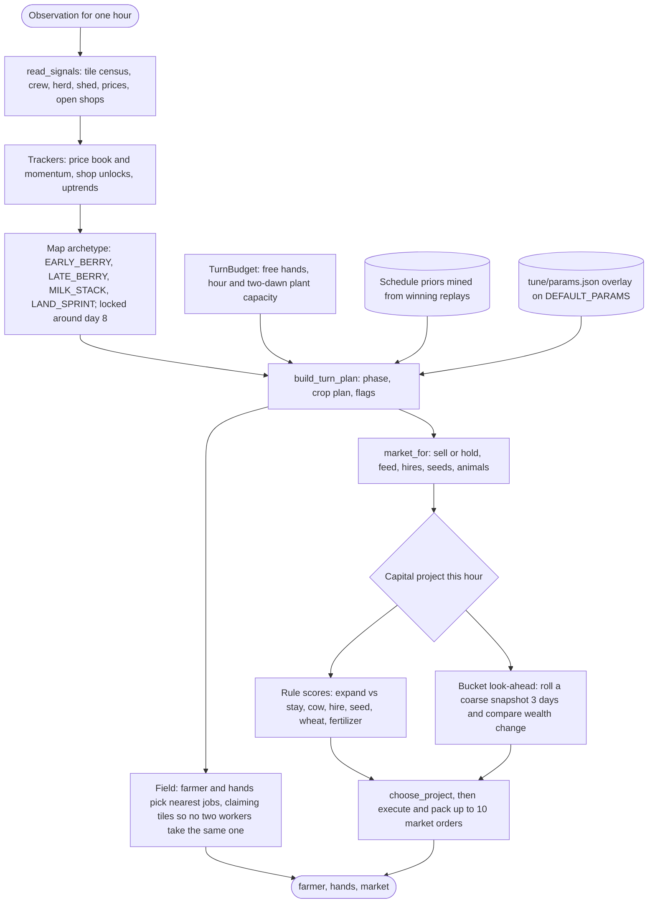

# Kaggriculture

A heuristic farming agent for Kaggle's [Kaggriculture](https://www.kaggle.com/competitions/kaggriculture) simulation competition. It plans each turn under a labor budget, ranks capital projects with a cheap look-ahead model, and is tuned against fixed seed panels and a ladder of real opponent bots.

## Why it's interesting

- **Bounded search, not brute force.** The game runs 720 turns. The agent does not simulate the full grid. Instead, `brain/lookahead.py` rolls a coarse farm snapshot forward 3 days (configurable, 2 to 5) in daily labor buckets, then compares land, cow, seed and hold by change in mark-to-market wealth. It is cheap enough to run every market hour. It is wrapped in a day window and a `try/except`, so a model error falls back to the rule-based choice instead of crashing the turn.
- **Explicit capacity budgeting.** Every turn starts with a `TurnBudget`: how many workers are free after feeding animals and watering crops, how many tiles they can plant this hour, and how many over two dawns. Land, hiring and seed purchases are all limited by that budget. Buying land the crew cannot plant is the most common way to lose money in this game.
- **Evaluation you can trust.** There are three layers. Seed panels against the built-in `starter` bot are fast. A holdout panel always sits next to the main panel and is never averaged into it. A ladder of real opponents (`tune/ladder.py`) reports win rate and margin. Optuna tuning is pruned when holdout scores drop, so a parameter set cannot win the main panel by failing elsewhere.
- **Reproducible.** Each seed set is a fixed list in code. All parameters live in one JSON file (`tune/params.json`) that the agent overlays on its defaults. A past submission can be rebuilt from a git commit with `git archive` and used as a frozen opponent (`frozen_73k6`). Regression tests pin score floors on named seeds.
- **Learning from replays.** `analysis/mine_schedules.py` mines winning replays for timing medians: hire curve, land days, herd size, liquidation day. `brain/schedules.py` uses these as priors. A map router turns them on only for board types where they don't cause regressions.

## The game in brief

Two players each run a farm for 30 in-game days of 24 hourly turns (720 steps). Each turn the agent issues one action for the farmer, one for each hired hand, and a list of market orders. The main mechanics:

- **Crops.** Wheat, carrot, tomato, strawberry and melon. Each has its own seed cost, growth time and yield, and needs labor to plant, water and harvest.
- **Animals.** Goose, cow and sheep produce eggs, milk and wool, and must be fed wheat.
- **Land.** The farm grows by buying extra plots of 25 tiles each (1,000, then 2,000, then 4,000 coins).
- **Hiring.** Hired hands get progressively more expensive.
- **Market.** Prices come from market inventory. Both players sell into the same market, and town shops open during the game and create demand for specific goods.

The score is final money. See the competition page for the exact rules.

## Architecture

`main.py` exposes `agent(obs)`. Each call is one hour of the game.



Key pieces:

| Module | Role |
|---|---|
| `main.py` | Entry point and policy: signals, crop plan, herd targets, land gates, field job assignment, market orders. |
| `brain/turn_budget.py` | Labor capacity, expand-vs-stay advantage for new land, per-project values, and `choose_project`. |
| `brain/lookahead.py` | Coarse 2 to 5 day forward model (feed, water, plant, produce, price drift) used to rank land, cow and seed. |
| `brain/market.py` | Price as a function of market inventory, sell and hold edges, how much to keep. |
| `brain/plan.py` | Phases (ENGINE, SPIKE, LATE_RAMP, ENDGAME, LIQUIDATE) and per-phase sell, field and market behavior. |
| `brain/map.py` | Classifies the board from open shops. Locked around day 8, with a provisional guess before and limited reclassification after. |
| `brain/playbook.py` | Shop-demand playbooks: how many tiles or animals to dedicate to each shop's product. |
| `brain/long_term.py` | Profit across all income streams (crops, milk, eggs, wool, inventory) for land and herd decisions. |
| `brain/schedules.py` | Loads timing priors from `analysis/schedules_by_archetype*.json`. |
| `brain/board.py`, `brain/dynamics.py` | Fill-the-board-before-buying-land rule, water stress, crew caps. |
| `main_v2.py`, `brain/v2/` | An experimental redesign (separate crop and herd plans). Select it with `KAGGRICULTURE_AGENT=main_v2.py`. |

The agent has no wall-clock timer. Turn time stays small because the look-ahead is a fixed-size bucket model, not a tree search over the grid.

## Repo layout

```
main.py              agent(obs) entry point and policy
main_v2.py           experimental v2 agent
submission.py        Kaggle entry point (re-exports agent from main.py)
brain/               planning, budgeting, look-ahead, market, archetypes, priors
brain/v2/            v2 crop-line / herd-line budget
tune/evaluate.py     seed panels vs starter (densify, holdout, dual) and path metrics
tune/ladder.py       win rate and margin vs opponent bots on fixed seeds
tune/optimize.py     Optuna search with regression guards and holdout pruning
tune/params.json     full parameter overlay read by the agent
tune/best_params.json  last tuned overlay
tune/sync_params.py  rewrite params.json from DEFAULT_PARAMS
tune/fetch_opponents.py  download public opponent bots (not included in this repo)
analysis/            replay mining scripts, schedule priors, investigation notes
tests/               unit tests for brain modules and full-episode regression floors
obs.json             sample observation
```

## Quickstart

Requires Python 3.10+.

```bash
python -m venv .venv
source .venv/bin/activate
pip install -r requirements.txt     # kaggle-environments, kaggle
pip install optuna                  # only needed for tune/optimize.py
```

Run one game against the built-in starter bot (seed 42):

```bash
python -m tune.evaluate --seedSet mean15 --seedCount 1
```

Or directly with `kaggle-environments`:

```python
from kaggle_environments import make

env = make("kaggriculture", configuration={"episodeSteps": 720, "seed": 42})
env.run(["main.py", "starter"])
print([s["reward"] for s in env.steps[-1]])   # final money per player
```

Evaluate on the panels:

```bash
python -m tune.evaluate --seedSet dual --paths     # 30 densify + holdout seeds, reported separately
python -m tune.evaluate --seedSet mean15           # fast 15-seed panel
```

Run the tests (the regression suite plays full 720-step games and takes a while):

```bash
python -m unittest discover -s tests
```

Ladder against a frozen past submission. This needs git history, because it rebuilds commit `5f379de` with `git archive`:

```bash
python -m tune.ladder --seedSet ladder20 --opponents frozen_73k6
python -m tune.ladder --seedSet holdout --opponents frozen_73k6 --both-seats
```

To ladder against public community bots, fetch them first. This needs the Kaggle CLI at `.venv/bin/kaggle` with your own credentials:

```bash
python -m tune.fetch_opponents
python -m tune.ladder --opponents frozen_73k6,ecobot_v2,structured,frontier_soil
```

Tune parameters:

```bash
python tune/optimize.py --trials 50 --densifyCount 15 --holdoutCount 8
python tune/sync_params.py      # after adding new DEFAULT_PARAMS keys
```

Submit to Kaggle: upload `submission.py`, `main.py` and `brain/`. <!-- TODO(Sumit): confirm whether tune/params.json and analysis/schedules_by_archetype*.json were bundled; the agent reads both if present. -->

## Results

All numbers below come from files in this repo. Local scores are final money against the built-in `starter` bot.

**Kaggle ladder** (from `analysis/kaggle_eps/latest_vs_last3.json`; ratings as captured at the time, not final standings):

| Submission | Change | Rating | Sampled ladder games (W–L) |
|---|---|---:|---:|
| 55630629 | unified brain | 514.9 | 12–17 |
| 55645717 | crew-tile water + look-ahead | 577.8 | 11–11 |
| 55646301 | elite/top5 replay priors | 645.0 | 11–12 |

Replaying the latest agent (against the starter bot) on the seeds of 74 earlier ladder games: it scored above that game's opponent in 56 of 74 (75.7%), and above its own earlier score in 67 of 74 (90.5%). The opponent in these replays is the starter bot, not the original opponent, so market interaction differs from a live head-to-head.

**Local panels** (from `analysis/dual_baseline_2026-08-21.md` and `analysis/plot3_qualify_2026-08-21.md`):

| Panel | Mean final money |
|---|---:|
| Densify panel (30 seeds) | 81,165 |
| Holdout panel (20 seeds) | 74,099 |
| Seeds 42 / 7 / 89 / 55 | 90,021 / 90,595 / 95,578 / 90,897 |

**Gap to the top.** The strongest public and ladder agents reached 100k to 170k on the same maps. Replay analysis in `analysis/` puts most of the gap in timing: winners buy a third plot around day 10, run 8 to 10 cows by day 10, and fill the new plot with strawberries within two days. This agent buys land later and leaves the new plot partly empty.

TODO(Sumit): add final leaderboard rank and score, and the date of the last submission.

## What I'd do next

- Buy the third plot earlier, but only when the crew can water and plant it: a water-aware fill rule instead of planting faster than the crew can water.
- Add a herd-expansion rule that fires only on the board types where it helps (holdout-style maps), instead of a global change that also hurts the densify maps.
- Extend the look-ahead to hiring and herd timing, and replace some hand-tuned rules with search over the same bucket model.
- Report confidence intervals on ladder win rates. Twenty seeds is a small sample.
- Split `main.py` (about 4,200 lines) into modules and either promote or retire the v2 agent.
- Run the 15-seed regression panel in CI on every change.

## Acknowledgements

- The [Kaggriculture](https://www.kaggle.com/competitions/kaggriculture) competition and the [kaggle-environments](https://github.com/Kaggle/kaggle-environments) simulator are by Kaggle.
- Replay analysis used Kaggle's daily Kaggriculture episode datasets and community notebooks by georgymamarin and destbreso.
- Opponent bots used for evaluation are **not included** in this repo. `tune/fetch_opponents.py` downloads them from their public sources: EcoBot v2 (premaananda108), Deterministic Farm Planning Agent (ameythakur20), Structured Economic Policy (pilkwang), Frontier: The Soil Remembers Rain (prvsiyan), and deepeshumrao's kaggriculture-agent on GitHub. Credit for those strategies belongs to their authors.
